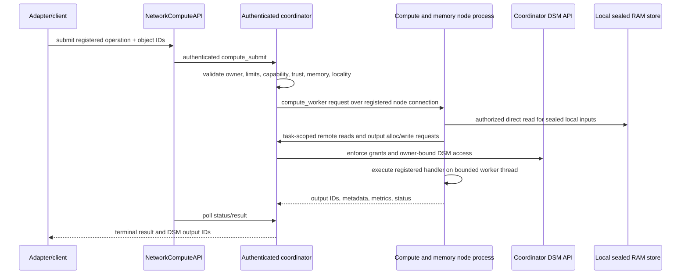

# Distributed Compute Status

**Current experimental measurements:** see [Final Experimental Results](FINAL_EXPERIMENTAL_RESULTS.md). That report supersedes the earlier smoke-run numbers below for the controlled direct-versus-mediated comparison and 1024-square capacity measurement; older numbers are retained here as historical context.

## Implemented

- **Generic compute foundation — IMPLEMENTED AND TESTED.** `compute/` defines serializable tasks/results, explicit handler registration, lifecycle state, bounded worker execution, metrics, and DSM-backed output objects. Application code cannot submit executable Python.
- **In-process API — IMPLEMENTED AND TESTED.** The API supports bounded submission, backpressure, status, cancellation, dependencies, and worker selection using input locations and active load.
- **Application handlers and adapters — IMPLEMENTED AND TESTED in-process.** Image invert/grayscale/blur handlers preserve tile core/halo behavior. Matrix multiplication creates block-product tasks and pairwise reductions; local execution also limits each multiply task to one A/B pair. Supplying `compute_api` selects compute execution; task errors do not fall back to client computation.
- **Authenticated remote transport — IMPLEMENTED AND TESTED across separate processes.** The protocol carries task submissions/status/cancel, worker requests/results, capability heartbeats, and task-scoped object access. `NetworkComputeAPI` uses a client's authenticated `RemoteDSMAPI`; the coordinator routes work to registered node processes. The worker may read only its assigned inputs and may write/free only outputs created under its task grant.
- **Node worker registration and discovery — IMPLEMENTED AND TESTED in that smoke test.** `scripts/node_main.py` starts registered image/matrix handlers by default. `DSM_COMPUTE_ENABLED=false` leaves a memory-only node; `NODE_COMPUTE_SLOTS` and `NODE_COMPUTE_MEMORY_BYTES` set worker capacity.
- **Remote multi-worker application proof — IMPLEMENTED AND TESTED locally.** `tests/integration/full_stack/test_remote_compute.py` starts three independent authenticated node processes. Node 1 shares the client/coordinator host; nodes 2 and 3 are separate resource processes on the same available machine. It distributes nine non-divisible image tiles for invert, grayscale, and halo blur, then multiplies rectangular 5×7 and 7×6 matrices with block size 3 (four output blocks, three inner products per block). Results match OpenCV/NumPy. The test requires tasks on all three registered nodes, overlapping execution, distinct output IDs, and worker PIDs separate from the client. This verifies multi-process participation on one host, not physical multi-computer operation.

## Remaining acceptance work

- **Multi-node scheduling and scaling — PARTIALLY IMPLEMENTED.** The coordinator selects a fresh, trusted node with the capability and declared memory, prefers nodes holding more input bytes, accounts for active slots, and can use `DSM_COMPUTE_SCHEDULER=round_robin`. The integration test verifies three resource processes, including one on the client host, on one physical machine. Physical-machine scaling and controlled policy comparisons remain unmeasured.
- **Immutable inputs, pinning, and direct local reads — IMPLEMENTED AND VERIFIED.** `seal()` is coordinated by the runtime and acknowledged by the memory node; writes are rejected after sealing at both layers. Remote compute submissions require sealed, owner-matched inputs and pin them before dispatch. `free()` rejects pinned inputs; pins are released in task `finally` handling. The coordinator sends the selected worker the local input IDs plus pinned versions. `CoordinatorDSMProxy` uses a restricted in-process `MemoryNode.read_sealed` path for those IDs, which checks task allowlist, owner, generation, node availability, sealed state, and content digest. Mutable/non-local reads keep the existing coordinator path. Local access copies bytes once from the bytearray store; it is not zero-copy.
- **Remote cancellation — PARTIALLY IMPLEMENTED.** A queued task can be cancelled. A running handler cannot yet be interrupted safely.
- **Retries and process/network failure — NOT IMPLEMENTED.** The coordinator does not retry failed work or recover orphaned outputs after process loss. Task grants and output cleanup work on normal task failure, but cleanup under abrupt network failure is not established.
- **Root cause and connection reliability fix — REPRODUCED AND REGRESSION-TESTED.** The failing workload generated repeated `compute_status` polling per task and worker object-access requests. Audit records showed rate-limit violations followed by worker trust escalation and connection closure; request/response correlation was not the cause. Compute RPCs now use their own bounded rate bucket, and `NetworkComputeAPI` serializes status polling with a 100 ms minimum interval. The two-worker multi-block regression passes without worker rate-limit events.
- **Cancellation and abrupt failures — PARTIAL.** Queued cancellation and task-failure output cleanup exist. A running handler cannot be interrupted safely, and coordinator recovery/retry after worker loss is not established.
- **Data locality — IMPLEMENTED AND MEASURED.** In the latest three-resource-process smoke benchmark, worker metrics recorded 2,168 direct local input bytes and 648 coordinator-mediated remote input bytes across distributed image and matrix rows. Direct reads run against the colocated node's sealed RAM store; they do not traverse the coordinator. Remote reads retain the authenticated coordinator path. These small payloads do not establish a general traffic reduction percentage.
- **Network and memory instrumentation — PARTIALLY MEASURED.** `Connection.stats()` counts framed protobuf bytes plus the 4-byte frame header, request/response counts, timeouts, duration, and payload-kind totals. The latest controlled experiment also snapshots coordinator-side node connections and reports client traffic separately, counting each coordinator/node link once. It does not observe TLS record bytes or direct node-to-node links. Worker task metrics report local/remote input reads, output writes, pins, and releases. See the current report for the measured traffic deltas and process RSS; old smoke-run numbers below have been superseded.
- **Performance and memory benchmark — CONTROLLED SMALL CASES AND ONE CAPACITY CASE.** The three-node mediated/direct comparison uses identical topology and settings, with two repetitions per case. Its tiny inputs do not establish an end-to-end speedup, though the matrix case substantially reduces coordinator/node framed application traffic. The 1024-square float32 capacity test succeeds under three logical 10 MiB storage limits using `.npy` memmaps and incremental output. See [raw controlled results](../results/controlled-mediated-3nodes.json), [direct results](../results/controlled-direct-3nodes.json), and [capacity results](../results/capacity-1024-f32-3nodes.json).
- **Docker/physical-LAN deployment — PREPARED, NOT VERIFIED.** Compose and a TLS/authenticated LAN runbook are present. Docker is unavailable in the current environment, and no second physical computer is available for this run.
- **Coordinator restart — VERIFIED.** The restart regression passed after the unrelated benchmark was removed from its intentionally degraded trust scenario; distributed compute and benchmark coverage live in the separate two-worker integration test.
- **Latest test evidence — PASSING.** The complete suite passed **535 tests with 1 skipped in 161.32 seconds** after the final immutable-input/direct-read, benchmark-timing, output/pinning metrics, and three-node integration changes. The three-node TLS integration checks tasks on all three resource processes, direct local and remote reads, image/matrix correctness, output uniqueness, concurrency, framed traffic, RSS, task counters, and that each native benchmark repetition executes its operation.

## Remote execution flow



## Security and resource boundaries

- Task owner identity comes from the authenticated client session, never a task field.
- Node identity comes from the authenticated node connection and is checked against the active grant and connection.
- The coordinator validates task size, parameter JSON, input ownership, dependencies, worker trust/capabilities, and task output grants.
- A worker can read only input IDs assigned to its task. Allocations are capped at 64 MiB per output; writes/frees are limited to task-created outputs.
- Handler code is registered by the node deployment. The wire protocol carries an operation name and JSON parameters, not code.
- Non-local and mutable object reads pass through the authenticated coordinator path; this is secure but adds network requests and central request-rate pressure.

## Verification

Focused two-worker separate-process test:

```powershell
.venv-lan\Scripts\python.exe -m pytest tests/integration/full_stack/test_remote_compute.py -vv -s
```

Latest three-node locality result: **1 passed as part of the complete suite**. It verifies image and matrix correctness, task execution on all three resource-node processes, overlapping task intervals, unique outputs, a two-mode controlled access comparison, the 1024-square capacity experiment, and two repetitions of native/local-tiled/distributed 256-square matrix execution. Processes ran on one physical host; this is not physical multi-computer evidence.

In-process focused regression:

```powershell
.venv-lan\Scripts\python.exe -m pytest tests/unit/compute tests/unit/test_image_adapter.py tests/unit/test_matrix_adpater.py tests/unit/test_adapter_contract.py -q
```

Latest result after remote transport changes: **63 passed**. The focused unit regression also includes compute and adapter lifecycle checks.

Latest complete regression result: **537 passed, 1 skipped in 267.50s** (`pytest -q --cache-clear`). The coordinator-restart integration test passed in the complete suite.
